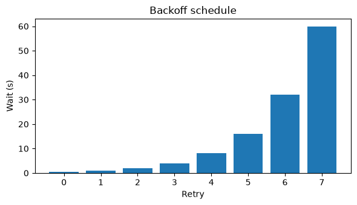
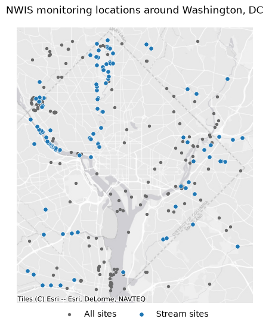
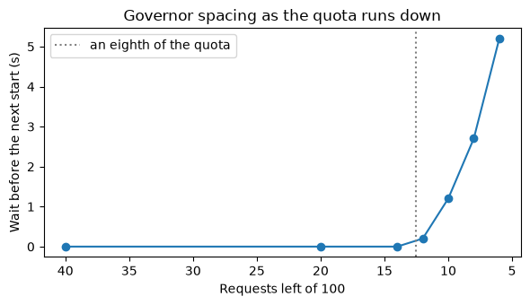

# Examples

Each card is a notebook from the repository's `docs/examples/` directory, rendered with
its saved outputs.

- [{ loading=lazy }](getting_started.md "Getting started")
    **Getting started**

- [{ loading=lazy }](nwis.md "Querying NWIS")
    **Querying NWIS**

- [{ loading=lazy }](cache_quota_resume.md "Cache, quota, and resume")
    **Cache, quota, and resume**

